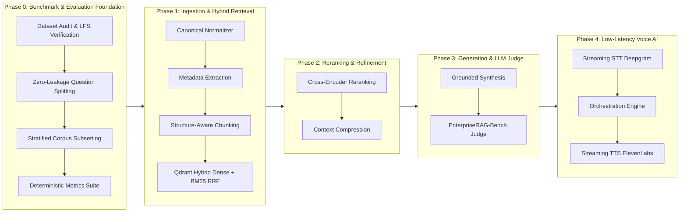

# 🎙️ VoiceEnterprise

> **An enterprise-grade, voice-first Retrieval-Augmented Generation (RAG) agent engineered for precision, latency, and complex workplace knowledge synthesis.**

[](https://www.python.org/)
[](LICENSE)
[]()
[](https://huggingface.co/datasets/onyx-dot-app/EnterpriseRAG-Bench)

---

## 🎯 Project Objective

Modern enterprise knowledge is fragmented across dozens of disconnected workplace tools—Slack conversations, Gmail threads, Jira tickets, Linear issues, Confluence wikis, Google Drive docs, GitHub pull requests, HubSpot customer records, and Fireflies meeting transcripts.

Traditional enterprise search fails when queries require multi-step reasoning, reconciling conflicting updates, or filtering temporal noise. **VoiceEnterprise** aims to solve this by building a real-time conversational voice agent that:
1. **Understands complex voice queries** in natural spoken language.
2. **Retrieves high-precision context** from a corpus of over half a million enterprise documents across 9 SaaS tools.
3. **Reconciles contradictions and temporal discrepancies** (e.g. outdated runbooks vs. recent Slack announcements).
4. **Responds in low-latency voice** (<1s time-to-first-audio-token) with faithful citations and verifiable provenance.

The entire system is rigorously developed and benchmarked against **EnterpriseRAG-Bench** (from Onyx), consisting of **511,962 enterprise documents** and **500 evaluation questions** spanning 10 complex question categories.

---

## 🗺️ Architectural Roadmap



| Phase | Focus Area | Status | Deliverables |
| :--- | :--- | :---: | :--- |
| **Phase 0** | **Dataset Audit, Leak-Free Protocol & Evaluation Engine** | ✅ **Completed** | Full LFS audit, leak-free graph splitting, 10k/12k subsets, official metrics suite |
| **Phase 1** | **Canonical Ingestion & Dense/Sparse Hybrid Retrieval** | ✅ **Completed** | Duplicate ID resolution, date/ticket metadata, structure chunker, Qdrant hybrid index |
| **Phase 2** | **Re-ranking, RRF Tuning & Context Compression** | 🔄 *Next* | Cross-encoder rerankers, temporal filtering, prompt context compaction |
| **Phase 3** | **Synthesis, Fact Attribution & Benchmark Scoring** | ⏳ *Planned* | LLM-as-a-judge correctness and completeness scoring against gold answers |
| **Phase 4** | **Voice-First Conversational Agent (STT + TTS)** | ⏳ *Planned* | Sub-second streaming audio pipeline with barge-in support and citation playback |

---

## 🔬 Phase 0 Accomplishments & Key Findings

### 1. Dataset Audit & Provenance Verification (P0.1)
- Audited the full **511,962 enterprise documents** (~1.41 GB) and **500 evaluation questions** from `onyx-dot-app/EnterpriseRAG-Bench`.
- Cryptographically verified SHA-256 checksums against Hugging Face Git LFS pointers:
  - `documents/test.parquet`: `6b0747bf16...` (511,962 rows, 9 source types)
  - `questions/test.parquet`: `e25066f4ef...` (500 questions, 10 query categories)
- **Referential Integrity**: 100% of all 722 distinct `expected_doc_ids` referenced across the 500 questions exist in the document corpus.
- **Corpus Findings Discovered**:
  - **Duplicate `doc_id` records**: 4 `doc_id`s appear twice with conflicting contents/titles across different source types (e.g. Confluence vs. Jira, Confluence vs. HubSpot).
  - **Missing fields**: 15 Slack documents lacked titles; 1 Slack document lacked body content.
- Generated canonical audit report in [`data/manifest.json`](file:///Users/kanchanpotdar/Downloads/voice%20ai%20/data/manifest.json).

### 2. Zero-Leakage Question Splitting Protocol (P0.2)
- Built a graph-based connected-component splitter (`data/split_questions.py`) to prevent evaluation contamination. Questions that share any gold document ID are clustered together and assigned atomically to the same split.
- Produced two leakage-free splits:
  - **Development Split (`questions_dev.parquet`)**: 193 questions, 277 unique gold documents, stratified across all 10 categories, tagged with **5-fold cross validation** indices for hyperparameter tuning.
  - **Held-Out Test Split (`questions_held_out_test.parquet`)**: 307 questions, 445 unique gold documents.
  - **Shared Gold Documents Between Splits**: **Exactly 0** (provably leak-free).
- Documented in [`data/splits/split_protocol.json`](file:///Users/kanchanpotdar/Downloads/voice%20ai%20/data/splits/split_protocol.json).

### 3. Fast Development Subsets with Hard Negatives (P0.3)
To enable rapid local experimentation without re-indexing all 512,000 documents on every iteration, built deterministic corpus subsets (`data/build_subset.py`):
- **`corpus_dev_10k.parquet`** (10,001 documents, ~29.2 MB): Conditioned **strictly** on the dev split. Contains 278 dev gold documents, 2,200 title-matched hard negatives, and 7,523 stratified background documents. **Zero held-out test contamination**.
- **`corpus_benchmark_conditioned_12k.parquet`** (11,937 documents, ~33.8 MB): Contains all 722 gold documents for full benchmark sanity checking.
- Documented with byte sizes, hashes, and inclusion provenance in [`data/subsets/subset_manifest.json`](file:///Users/kanchanpotdar/Downloads/voice%20ai%20/data/subsets/subset_manifest.json).

### 4. Official Evaluation Metrics Engine (P0.4)
Implemented deterministic retrieval and scoring metrics in [`evaluation/metrics.py`](file:///Users/kanchanpotdar/Downloads/voice%20ai%20/evaluation/metrics.py):
- **Recall@K** and **Recall (all)**: Accurately handles edge cases (returns `None` instead of 0 for unanswerable/info_not_found questions so averages are not artificially deflated).
- **Hit@K** & **MRR@K** (Mean Reciprocal Rank).
- **Invalid Extra Docs@K**: Penalizes retrieval systems returning irrelevant noise.
- **Overall Score**: Official EnterpriseRAG-Bench scoring ($Completeness \times Correctness$).
- Automated per-category breakdowns with low-sample warnings for categories where $n < 15$.

---

## ⚡ Phase 1 Ingestion & Hybrid Retrieval (Preview)

In addition to Phase 0, Phase 1 core pipelines are already implemented and tested:
1. **Document Normalizer (`ingestion/normalizer.py`)**: Resolves duplicate `doc_id` records by deterministic versioning (`{doc_id}__v1`, `{doc_id}__v2`) and creates informative fallback titles for untitled Slack messages.
2. **Metadata Extractor (`ingestion/metadata.py`)**: Deterministically identifies ISO dates (with confidence scoring based on title/revision header vs. body), Slack channels (`#channel`), Jira/Linear tickets (`ENG-123`), and email addresses.
3. **Structure-Aware Chunker (`ingestion/chunker.py`)**: Parses markdown headings, packs small sections, and preserves hierarchical breadcrumbs (`[Source | Title | Section]`).
4. **Qdrant Hybrid Indexer (`retrieval/indexer.py`)**: Employs `BAAI/bge-small-en-v1.5` dense embeddings (Metal/MPS accelerated on Apple Silicon) alongside `Qdrant/bm25` sparse vectors fused via Reciprocal Rank Fusion (RRF).

---

## 📂 Repository Structure

```
.
├── .env.example                       # Environment configuration template
├── .gitignore                          # Excludes datasets, parquet binaries, and secrets
├── pyproject.toml                      # Pytest and module configuration
├── README.md                           # Project documentation and roadmap
│
├── data/
│   ├── audit.py                        # Dataset audit & SHA-256 verification
│   ├── manifest.json                   # Machine-readable audit report
│   ├── split_questions.py              # Connected-component leak-free question splitter
│   ├── build_subset.py                 # 10k/12k corpus subset sampler with hard negatives
│   ├── splits/
│   │   └── split_protocol.json         # Split metadata, seeds, and category distributions
│   └── subsets/
│       └── subset_manifest.json        # Subset provenance and sampling statistics
│
├── evaluation/
│   ├── __init__.py
│   └── metrics.py                      # Recall@K, Hit@K, MRR@K, Invalid Extra Docs suite
│
├── ingestion/
│   ├── __init__.py
│   ├── normalizer.py                   # Canonical normalization & duplicate-ID resolution
│   ├── metadata.py                     # Deterministic date, ticket, and channel extraction
│   ├── chunker.py                      # Structure-aware heading and section chunker
│   └── pipeline.py                     # End-to-end ingestion orchestrator
│
├── retrieval/
│   ├── __init__.py
│   ├── indexer.py                      # Qdrant Dense (BGE) + Sparse (BM25) hybrid retriever
│   └── benchmark_p1.py                 # Retrieval benchmark evaluation runner
│
└── tests/
    ├── test_p0_pipeline.py             # Phase 0 integrity, leak-free, and subset tests
    ├── test_metrics.py                 # Unit tests for evaluation metrics
    ├── test_ingestion.py               # Normalizer, metadata, and chunker tests
    └── test_retrieval.py               # Hybrid retriever and Qdrant integration tests
```

---

## 🚀 Quickstart

### 1. Setup Environment
```bash
# Clone the repository
git clone https://github.com/kanchanpotdar/voicenterprise.git
cd voicenterprise

# Create and activate virtual environment
python3.11 -m venv .venv
source .venv/bin/activate

# Install dependencies
pip install -r requirements.txt  # or install duckdb pyarrow pandas qdrant-client transformers fastembed pytest
cp .env.example .env
```

### 2. Run Automated Test Suite
```bash
pytest tests -v
```
All 14 tests across Phase 0 and Phase 1 should pass.

### 3. Re-generate Audits & Leak-Free Splits
```bash
# Audit raw EnterpriseRAG-Bench data (if raw dataset is downloaded)
python -m data.audit

# Generate leak-free dev & held-out test splits
python -m data.split_questions

# Build 10k development subset
python -m data.build_subset
```

---

## 📄 License
This project is licensed under the MIT License - see the LICENSE file for details.
EnterpriseRAG-Bench dataset is released under the MIT License by Onyx.
