# VoiceEnterprise: Voice-First Enterprise Knowledge Investigator

[](https://www.python.org/)
[](#15-license-and-dataset-attribution)
[](#12-test-and-diagnostic-commands)
[](https://huggingface.co/datasets/onyx-dot-app/EnterpriseRAG-Bench)

---

## 1. Project Overview and Motivation

Enterprise knowledge is fragmented across heterogeneous internal systems: chat threads (Slack), email correspondence (Gmail), issue trackers (Linear, Jira), collaborative documentation (Confluence, Google Drive), pull requests (GitHub), CRM records (HubSpot), and meeting transcripts (Fireflies). Answering real operational questions requires more than retrieving a few similar paragraphs—it requires searching across multiple sources, tracking identifiers and timestamps, surfacing conflicting or superseded records, and abstaining when evidence is missing.

**Long-Term Product Goal:** Build a **Voice-First Enterprise Knowledge Investigator** capable of accepting spoken questions, performing multi-source evidence retrieval and synthesis, resolving or highlighting conflicting facts with traceable citations, abstaining on unanswerable queries, and delivering concise spoken responses through a real-time voice interface.

**Engineering Philosophy:** Rather than building a voice frontend or multi-agent graph first and evaluating it on ad-hoc demo queries, this project follows a strict, measurement-driven progression. Phases 0 and 1 establish a cryptographically verified dataset audit, a zero-leakage evaluation split, a provenance-preserving ingestion pipeline, and a reproducible retrieval benchmark comparing lexical (BM25), dense (`BAAI/bge-small-en-v1.5`), and hybrid Reciprocal Rank Fusion (RRF) retrieval.

---

## 2. What Is Implemented Through Phase 1

To maintain strict technical clarity between the completed foundation and planned downstream phases:

| Capability | Status | Implemented Module(s) |
| :--- | :---: | :--- |
| **Dataset Cryptographic Audit & Manifest (P0.1)** | **Implemented** | `data/audit.py`, `data/manifest.json` |
| **Zero-Leakage Connected-Component Split Protocol (P0.2)** | **Implemented** | `data/split_questions.py`, `data/splits/split_protocol.json` |
| **Deterministic Corpus Subsetting & Hard-Negative Mining (P0.3)** | **Implemented** | `data/build_subset.py`, `data/subsets/subset_manifest.json` |
| **Deterministic Retrieval Evaluation Metrics (P0.4)** | **Implemented** | `evaluation/metrics.py` |
| **Canonical Normalization & Duplicate-ID Conflict Preservation (P1.1)** | **Implemented** | `ingestion/normalizer.py` |
| **Deterministic Metadata Extraction with Confidence Tiers (P1.2)** | **Implemented** | `ingestion/metadata.py` |
| **Structure-Aware Markdown & Transcript Chunking (P1.3)** | **Implemented** | `ingestion/chunker.py`, `ingestion/pipeline.py` |
| **Qdrant Dense (`BGE-small-en-v1.5`) + Sparse (`BM25` IDF) Indexing (P1.4)** | **Implemented** | `retrieval/indexer.py` |
| **BM25 vs. Dense vs. Hybrid RRF Benchmark & Diagnostics (P1.5)** | **Implemented** | `retrieval/benchmark_p1.py`, `evaluation/inspect_p1_checks.py` |
| **Grounded Answer Generation, Citations & Abstention (Phase 2)** | *Planned* | Not yet implemented |
| **Multi-Hop Investigation, Conflict Resolution & Entity Graph (Phase 3)** | *Planned* | Not yet implemented |
| **Real-Time Streaming Voice Interface — STT / TTS / LiveKit (Phase 4–5)** | *Planned* | Not yet implemented |

---

## 3. System Architecture and Retrieval Pipeline

The currently implemented Phase 0–1 pipeline transforms raw enterprise records into searchable, provenance-preserving chunks and evaluates three retrieval paradigms against ground-truth benchmark questions:

```mermaid
flowchart LR
    subgraph P0["Phase 0: Audit, Splits & Subsets"]
        A1["EnterpriseRAG-Bench\n(511,962 docs, 500 questions)"] --> A2["Cryptographic Audit\n(data/audit.py)"]
        A2 --> A3["Connected-Component Split\n193 Dev / 307 Held-Out Test\n(data/split_questions.py)"]
        A3 --> A4["Deterministic Subsets\n10k Dev / 12k Conditioned\n(data/build_subset.py)"]
    end

    subgraph P1["Phase 1: Ingestion, Indexing & Retrieval Benchmark"]
        B1["Normalized Records\nDuplicate-ID Versioning\n(ingestion/normalizer.py)"] --> B2["Metadata Extraction\nDates, Tickets, Channels\n(ingestion/metadata.py)"]
        B2 --> B3["Structure-Aware Chunks\n34,354 Chunks (max 2000 chars)\n(ingestion/chunker.py)"]
        B3 --> B4["Qdrant Dual Index\nDense: BGE-small-en-v1.5 (384d)\nSparse: Qdrant/bm25 + IDF\n(retrieval/indexer.py)"]
        B4 --> B5["Retrieval Modes\n1. BM25-only\n2. Dense-only\n3. Hybrid RRF"]
        B5 --> B6["Evaluation & Diagnostics\n(retrieval/benchmark_p1.py\nevaluation/inspect_p1_checks.py)"]
    end

    A4 --> B1
```



**Data Flow Summary:**
`Raw Parquet Records` $\rightarrow$ `Normalized Records (versioned duplicate IDs, fallback titles)` $\rightarrow$ `Metadata-Enriched Records (dates, confidence, tickets, channels)` $\rightarrow$ `Structure-Aware Chunks (34,354 chunks with [Source | Title | Section] headers)` $\rightarrow$ `Qdrant Dual Vector Index (Dense Cosine + Sparse BM25 IDF)` $\rightarrow$ `Document-Level Deduplicated Retrieval (BM25 / Dense / Hybrid RRF)` $\rightarrow$ `Per-Category Benchmark & Failure Diagnostics`.

---

## 4. Dataset Description and Source-Type Distribution

The project uses [**EnterpriseRAG-Bench**](https://huggingface.co/datasets/onyx-dot-app/EnterpriseRAG-Bench) (`onyx-dot-app/EnterpriseRAG-Bench`, pinned at commit `69916e31c68aa5963c00248fd7f0bc12d04fd235`), a synthetic enterprise corpus simulating an AI inference-as-a-service company ("Redwood Inference"). The dataset is strictly text-only (`doc_id`, `source_type`, `title`, `content`) and contains **511,962 document rows** (`511,958` unique `doc_id`s) and **500 benchmark questions**.

### Document Corpus Distribution (`data/documents/test.parquet` — 1.41 GB)

| Source Type | Document Count | Corpus Share | Avg Length (chars) | Median Length (chars) | Content Description |
| :--- | ---: | ---: | ---: | ---: | :--- |
| `slack` | 285,605 | 55.79% | 3,347.9 | 3,239 | Internal engineering, support, and release channels |
| `gmail` | 121,390 | 23.71% | 7,102.0 | 7,036 | Internal and customer-facing email threads |
| `linear` | 35,308 | 6.90% | 5,180.7 | 5,041 | Engineering, product, and design issue tickets |
| `google_drive` | 25,108 | 4.90% | 7,052.6 | 7,005 | Design docs, notes, and collaborative specifications |
| `hubspot` | 15,017 | 2.93% | 3,139.0 | 3,025 | Sales CRM account briefs and deal records |
| `fireflies` | 10,173 | 1.99% | 11,493.0 | 11,080 | Automated meeting transcripts |
| `github` | 8,052 | 1.57% | 4,723.5 | 4,616 | Pull requests and code review discussions |
| `jira` | 6,120 | 1.20% | 5,532.8 | 5,558 | Customer support and infrastructure tickets |
| `confluence` | 5,189 | 1.01% | 9,782.7 | 9,579 | SRE runbooks, playbooks, and architecture wikis |

### Question Category Distribution (`data/questions/test.parquet` — 500 Questions)

| Category | Total | Dev Split | Held-Out Test | Gold Docs / Question | Avg Atomic Facts |
| :--- | ---: | ---: | ---: | :---: | ---: |
| `basic` | 175 | 61 | 114 | 1 (min 1, max 1) | 2.93 |
| `semantic` | 125 | 44 | 81 | 1 (min 1, max 1) | 4.00 |
| `intra_document_reasoning` | 40 | 14 | 26 | 1 (min 1, max 1) | 2.75 |
| `project_related` | 40 | 14 | 26 | 2–9 (median 3.5) | 11.72 |
| `constrained` | 30 | 15 | 15 | 1–2 (median 1.0) | 10.57 |
| `completeness` | 20 | 10 | 10 | 2–10 (median 6.0) | 14.20 |
| `conflicting_info` | 20 | 10 | 10 | 2 (min 2, max 2) | 6.90 |
| `miscellaneous` | 20 | 10 | 10 | 1 (min 1, max 1) | 2.30 |
| `info_not_found` | 20 | 10 | 10 | 0 (unanswerable) | 1.00 |
| `high_level` | 10 | 5 | 5 | 0 (broad synthesis) | 3.00 |
| **Total** | **500** | **193** | **307** | **722 unique gold docs** | — |

---

## 5. Data Preparation, Normalization, Metadata, and Chunking

### 5.1 Cryptographic Audit & Data Anomalies (`data/audit.py`)
- Both upstream Parquet files are verified by SHA-256 against their Hugging Face Git LFS pointers (`data/manifest.json`).
- **Referential Integrity:** All **722** unique `expected_doc_ids` across the 500 questions exist in `documents/test.parquet` (`missing_from_corpus: 0`).
- **Duplicate `doc_id` Discovery:** The raw 511,962-row corpus contains **4 duplicate `doc_id`s** (`511,958` unique `doc_id`s). All 4 pairs have **divergent content and titles** (and in 3 cases, different `source_type`s, such as `confluence` vs. `jira` or `confluence` vs. `hubspot`). Crucially, `dsid_6df52fdb96ae4edcb76464738bca3340` appears as two distinct Jira tickets (*"Cleanup stale test instances... (archived volumes)"* at 4,520 chars vs. *"Cleanup stale test instances..."* at 2,755 chars) and is a ground-truth document for `qst_0413` (`conflicting_info`).
- **Missing Fields:** 15 `slack` records have an empty `title` (`""`), and 1 `slack` record (`dsid_33cbedf0709949fd9416c8c864a86cf2`) has empty `content` (`""`).

### 5.2 Leakage-Free Split Protocol (`data/split_questions.py`)
- Because 20 gold document references are shared across multiple benchmark questions, `data/split_questions.py` constructs a bipartite graph of questions and `expected_doc_ids`, finds connected components (`11` multi-question components), and assigns entire components atomically (`seed = 42`).
- **Result:** `questions_dev.parquet` (`193` questions, `277` unique gold docs) and `questions_held_out_test.parquet` (`307` questions, `445` unique gold docs) share **0 gold documents** (`shared_expected_docs_between_splits: 0`).
- Categories with $\le 30$ total questions receive a 50% dev allocation to avoid tiny development counts; categories with $\ge 40$ questions receive 35%. Development questions are also assigned stratified 5-fold cross-validation indices (`dev_fold` $0\dots4$).

### 5.3 Corpus Subsetting (`data/build_subset.py`)
To enable fast local iteration without contaminating development experiments with held-out labels, two subsets are generated with an explicit `inclusion_reason` provenance column:
1. **`corpus_dev_10k.parquet` (`10,001` rows / `10,000` unique `doc_id`s, `29.19 MB`):** Conditioned **strictly on the development split** (`conditioned_on_held_out_questions: false`). Contains:
   - `278` `dev_gold` rows (`277` unique `doc_id`s, preserving both conflicting Jira versions of `dsid_6df52fdb96ae4edcb76464738bca3340`),
   - `2,200` `dev_hard_negative` rows mined by matching distinctive title tokens from `dev_gold` documents, and
   - `7,523` `stratified_background` rows sampled proportionally across all 9 source types.
2. **`corpus_benchmark_conditioned_12k.parquet` (`11,937` rows / `11,936` unique `doc_id`s, `33.84 MB`):** Adds the remaining `436` `held_out_gold` documents (9 were incidentally sampled in `dev_10k`) and `1,500` `held_out_hard_negative` documents. **Methodological Warning:** Because this 12k subset is conditioned on benchmark labels, it must only be used for clearly labeled benchmark-conditioned experiments, never reported as unbiased retrieval over the full 511,962-document corpus.

### 5.4 Normalization, Metadata Extraction, and Structure-Aware Chunking (`ingestion/`)
- **Normalization (`ingestion/normalizer.py`):** Deduplicates exact `(doc_id, source_type, title, content_sha256)` matches while preserving distinct records sharing a `doc_id` under deterministic `record_id`s (`{doc_id}__v1`, `{doc_id}__v2`) with `has_duplicate_doc_id_conflict = True`. Synthesizes fallback titles (`[source_type] <opening snippet>`) when `raw_title` is empty while preserving `raw_title` and `raw_content`.
- **Metadata Extraction (`ingestion/metadata.py`):** Deterministically extracts explicit ISO dates (`2020–2029`), Slack channels (`#channel`), Jira/Linear ticket keys (`ENG-4021`, `SUP-48271`), PR numbers (`PR-188`), and emails without guessing missing values. Across `corpus_dev_10k.parquet`:
  - `4,146` documents have extracted dates (`1,914` `high` confidence from titles or `Revision history:` / `Change log:` blocks; `2,232` `medium` confidence from body text; `5,855` `none`).
  - `4,519` documents have ticket/PR IDs, `1,093` have Slack channels, and `3,210` have email addresses.
- **Structure-Aware Chunking (`ingestion/chunker.py`):** Splits documents along Markdown headings (`#`–`####`) and dividers (`---`), packs adjacent short sections up to `max_chunk_chars = 2000` with `overlap_chars = 200` (fitting within `BAAI/bge-small-en-v1.5`'s 512-token window), and prefixes `contextualized_text` with `Source: {source_type} | Title: {normalized_title} | Section: {section_title}`. Across `corpus_dev_10k.parquet`, this produces **34,354 chunks** (`avg_chunks_per_doc = 3.44`, `avg_chunk_chars = 1,613.1`, `max_chunk_chars_observed = 2,187`).

---

## 6. Retrieval Methods: BM25, BGE-Small Dense Retrieval, and Hybrid RRF

Implemented in `retrieval/indexer.py` (`EnterpriseRetriever`), each chunk is indexed into Qdrant (`collection_name = "enterprise_rag_dev_10k"`) with a deterministic UUIDv5 point ID (`uuid5(NAMESPACE_OID, f"enterpriserag_chunk:{chunk_id}")`) and two named vector representations:

1. **BM25 Sparse Retrieval (`mode="bm25"`):**
   - Uses `fastembed.SparseTextEmbedding(model_name="Qdrant/bm25")` (Snowball stemming, stopword filtering, and Okapi BM25 term-frequency saturation / length normalization) paired with `models.SparseVectorParams(modifier=models.Modifier.IDF)` in Qdrant so true collection-wide Inverse Document Frequency (IDF) weighting is applied at query time.
2. **Dense Semantic Retrieval (`mode="dense"`):**
   - Uses `BAAI/bge-small-en-v1.5` (`384` dimensions, Cosine similarity, L2-normalized CLS pooling).
   - Accelerated on Apple Silicon via PyTorch Metal Performance Shaders (`mps`, `torch.float16`) with length-sorted dynamic batching (`batch_size = 128`) during indexing and the standard BGE v1.5 query instruction prefix (`"Represent this sentence for searching relevant passages: "`) at query time.
3. **Hybrid Reciprocal Rank Fusion (`mode="hybrid"`):**
   - Executes Qdrant `Prefetch` queries against both `"dense"` and `"bm25"` (`prefetch_limit = max(top_k_chunks * 2, 50)`) and fuses rankings via `models.FusionQuery(fusion=models.Fusion.RRF)`.
4. **Chunk-to-Document Aggregation:**
   - For a target document cutoff $K$ (`top_k_docs = 20`), the retriever fetches $4 \times K = 80$ chunks and performs order-preserving deduplication by parent `doc_id` so multiple chunks from the same document never inflate document recall or consume multiple top-$K$ document slots.

---

## 7. Benchmark Methodology, Metrics, Results, and Interpretation

### 7.1 Evaluation Methodology and Metrics (`evaluation/metrics.py`)
- Evaluated on the full development split (`data/splits/questions_dev.parquet`, **193 total questions**) against the unconditioned development corpus (`corpus_dev_10k.parquet`, `34,354` chunks across `10,000` unique `doc_id`s).
- Out of the 193 development questions, **178 questions** have $\ge 1$ ground-truth `expected_doc_ids` and are eligible for document retrieval metrics (`Recall@K`, `Hit@K`, `MRR@K`). The remaining **15 questions** (`10` `info_not_found` and `5` `high_level`) have `0` expected documents; `evaluation/metrics.py` returns `None` for their recall/hit/MRR so they do not distort retrieval denominators, while including all 193 questions in `Invalid Extra Docs@K`.

### 7.2 Full Development Benchmark Results (`n = 193` Total / `178` with Gold Docs)
Verified from `evaluation/reports/p1_retrieval_benchmark_dev.json`:

| Metric | BM25 (`Qdrant/bm25` + IDF) | Dense (`BAAI/bge-small-en-v1.5`) | Hybrid RRF (Dense + BM25) |
| :--- | ---: | ---: | ---: |
| **Recall@1** | **65.92%** | 50.35% | 62.10% |
| **Recall@5** | 82.64% | 70.19% | **85.09%** |
| **Recall@10** | **91.77%** | 75.30% | 89.04% |
| **Recall@20** | **94.03%** | 78.56% | 92.98% |
| **Hit@5** | 86.52% | 74.72% | **89.33%** |
| **Hit@10** | **93.82%** | 79.21% | 91.57% |
| **MRR@10** | **0.8353** | 0.6751 | 0.8134 |
| **Invalid Extra Docs@5** | **3.87** | 4.07 | **3.87** |

### 7.3 Per-Category Breakdown on Full Development Set (`Recall@5` / `Recall@10`)

| Question Category | Dev $n$ (Gold-Eligible) | Gold Docs / Q | BM25 R@5 / R@10 | Dense R@5 / R@10 | Hybrid RRF R@5 / R@10 | Low-Sample Flag ($n < 15$) |
| :--- | ---: | :---: | ---: | ---: | ---: | :---: |
| `basic` | 61 (61) | 1 | 90.16% / **96.72%** | 81.97% / 85.25% | **95.08%** / 95.08% | No |
| `semantic` | 44 (44) | 1 | 61.36% / **81.82%** | 38.64% / 47.73% | **65.91%** / 75.00% | No |
| `constrained` | 15 (15) | 1–2 | 96.67% / 96.67% | **100.00% / 100.00%** | **100.00% / 100.00%** | No |
| `intra_document_reasoning` | 14 (14) | 1 | **100.00% / 100.00%** | 78.57% / 92.86% | **100.00% / 100.00%** | Yes ($n=14$) |
| `project_related` | 14 (14) | 2–9 | **81.23%** / 90.95% | 72.10% / 77.46% | 79.09% / **92.78%** | Yes ($n=14$) |
| `conflicting_info` | 10 (10) | 2 | **95.00% / 100.00%** | 85.00% / 85.00% | **95.00%** / 95.00% | Yes ($n=10$) |
| `completeness` | 10 (10) | 2–10 | **57.19% / 71.12%** | 33.50% / 36.83% | 48.86% / 60.11% | Yes ($n=10$) |
| `miscellaneous` | 10 (10) | 1 | **100.00% / 100.00%** | **100.00% / 100.00%** | **100.00% / 100.00%** | Yes ($n=10$) |
| `info_not_found` | 10 (0) | 0 | N/A (`5.0` extra@5) | N/A (`5.0` extra@5) | N/A (`5.0` extra@5) | Yes ($n=10$) |
| `high_level` | 5 (0) | 0 | N/A (`5.0` extra@5) | N/A (`5.0` extra@5) | N/A (`5.0` extra@5) | Yes ($n=5$) |

### 7.4 Interpretation of Findings
1. **BM25 Is a Strong Baseline on Identifier-Heavy Enterprise Text:** Because `EnterpriseRAG-Bench` queries frequently reference exact config parameters (`max_file_size`), metric names (`stream.timebox_finalized`), ticket keys (`SUP-48271`), and project codenames, BM25 with IDF achieves **91.77% Recall@10** and **94.03% Recall@20**, outperforming 384-dim `BAAI/bge-small-en-v1.5` (`75.30% Recall@10`) by **+16.47 points**.
2. **Hybrid RRF Improves Top-5 Precision (`Recall@5` and `Hit@5`):** Combining BM25 and Dense via RRF achieves the highest overall **`Recall@5` (85.09%)** and **`Hit@5` (89.33%)**, improving `Recall@5` over BM25 on `basic` (`95.08%` vs. `90.16%`), `semantic` (`65.91%` vs. `61.36%`), and `constrained` (`100.00%` vs. `96.67%`).
3. **Why Unweighted RRF Slightly Trails BM25 at `Recall@10` (`89.04%` vs. `91.77%`):** Equal-weight 50/50 RRF between a strong lexical ranker (`91.77%`) and a weaker 384-dim dense ranker (`75.30%`) allows false-positive dense hits on `completeness` and `semantic` queries to push some rank 6–10 BM25 hits below rank 10.
4. **Diagnostic Sample Distinction:** The CLI tool `evaluation/inspect_p1_checks.py` also supports a fast, deterministic 30-question round-robin diagnostic sample (`--check 2 --mode compare --sample-size 30`) for interactive error inspection. Diagnostic sample numbers are strictly for qualitative failure analysis and must not be conflated with the full 193-question development benchmark above.

---

## 8. Known Limitations and Unresolved Retrieval Errors

1. **Multi-Document Budget Ceiling on `completeness` Queries (`multi_doc_budget`):** `completeness` questions require retrieving up to **10** ground-truth documents (median `6.0`). A fixed top-5 document cutoff mathematically caps recall on questions with $>5$ gold documents; even at top-10, `Recall@10` is `71.12%` (BM25) and `60.11%` (Hybrid).
2. **Roundabout Phrasing in `semantic` Queries (`lexical_semantic_gap` & `ranking_suboptimal`):** `semantic` questions intentionally avoid exact terminology from the target document (e.g., asking about *"low bit math safer for inference"* instead of `FP8`/`INT8` fallback thresholds). `BAAI/bge-small-en-v1.5` achieves only `38.64% Recall@5` (`47.73% Recall@10`), and Hybrid achieves `65.91% Recall@5` (`75.00% Recall@10`).
3. **Cross-Document Link Following Not Yet Active:** In `project_related` queries (e.g., `qst_0343`), the top-1 retrieved Slack chunk explicitly cites a linked Jira ticket (`SUP-48271`), but single-shot retrieval does not yet perform a second-hop lookup on extracted `ticket_ids`.
4. **No Relevance Threshold / Abstention Gate Yet:** The retrieval layer always returns `top_k_docs` candidates, resulting in `5.0` `Invalid Extra Docs@5` on `info_not_found` and `high_level` queries until Phase 2 introduces confidence thresholding and LLM abstention.
5. **Local SQLite Qdrant Sparse Query Latency:** Running Qdrant in embedded local-disk mode (`QdrantClient(path="data/qdrant_dev_10k")`) without a Qdrant server/Docker instance scans 34,354 sparse vectors on disk in ~1.4s/query (`1,395 ms` BM25 / `1,706 ms` Hybrid vs. `54 ms` Dense). Running Qdrant in Docker or in-memory eliminates this disk-scan overhead.

---

## 9. Repository Structure

```text
.
├── .env.example                                   # Template for future LLM/Voice/Qdrant env vars
├── .gitignore                                     # Excludes .venv, *.parquet, and local Qdrant DB
├── pyproject.toml                                 # Dependencies and pytest configuration
├── README.md                                      # Project documentation and benchmark report
│
├── data/
│   ├── audit.py                                   # P0.1: SHA-256 & schema audit of full dataset
│   ├── split_questions.py                         # P0.2: Connected-component leak-free splitter
│   ├── build_subset.py                            # P0.3: Deterministic 10k dev & 12k subsets
│   ├── manifest.json                              # P0.1 output: verified hashes & corpus stats
│   ├── splits/
│   │   └── split_protocol.json                    # P0.2 output: split counts & holdout rules
│   ├── subsets/
│   │   └── subset_manifest.json                   # P0.3 output: subset sizes & provenance counts
│   └── ingested/
│       └── dev_10k/
│           ├── ingestion_manifest.json            # P1.1-P1.3 output: chunk & metadata stats
│           └── index_manifest.json                # P1.4 output: Qdrant model & index metadata
│
├── ingestion/
│   ├── __init__.py
│   ├── normalizer.py                              # P1.1: Canonical schema & duplicate-ID versioning
│   ├── metadata.py                                # P1.2: Deterministic dates, tickets, channels
│   ├── chunker.py                                 # P1.3: Structure-aware section chunking
│   └── pipeline.py                                # P1.1-P1.3 end-to-end ingestion runner
│
├── retrieval/
│   ├── __init__.py
│   ├── indexer.py                                 # P1.4: Qdrant Dense (BGE) + Sparse (BM25 IDF)
│   └── benchmark_p1.py                            # P1.5: Full 193-question dev benchmark runner
│
├── evaluation/
│   ├── __init__.py
│   ├── metrics.py                                 # P0.4: Recall@K, Hit@K, MRR@K, InvalidExtraDocs
│   ├── inspect_p1_checks.py                       # P1.5: 7-point diagnostic CLI & mode comparison
│   └── reports/
│       └── p1_retrieval_benchmark_dev.json        # Full 193-question dev benchmark report
│
└── tests/
    ├── test_p0_pipeline.py                        # P0 manifest, zero-leakage split & subset tests
    ├── test_metrics.py                            # Unit tests for retrieval & answer score metrics
    ├── test_ingestion.py                          # Duplicate-ID, empty-field, metadata & chunk tests
    ├── test_retrieval.py                          # Idempotent indexing & 3-mode retrieval smoke test
    └── test_diagnostics.py                        # Stratified sampling & failure-label unit tests
```

---

## 10. Environment Setup and Dependencies

Requires **Python 3.11+**. No external API keys or Docker containers are required for Phase 0 or Phase 1.

```bash
# 1. Clone the repository
git clone https://github.com/kanchanpotdar/voicenterprise.git
cd voicenterprise

# 2. Create and activate a Python 3.11 virtual environment
python3.11 -m venv .venv
source .venv/bin/activate

# 3. Install project dependencies and test suite
pip install --upgrade pip
pip install -e ".[dev]"
```

Core dependencies (defined in `pyproject.toml`): `pyarrow`, `pandas`, `duckdb`, `numpy`, `qdrant-client`, `fastembed`, `rank-bm25`, `torch`, `transformers`, and `pytest`.

---

## 11. Step-by-Step Commands to Reproduce the Phase 0–1 Pipeline and Benchmark

### Step 1: Download the Upstream `EnterpriseRAG-Bench` Dataset (1.41 GB)
```bash
git clone https://huggingface.co/datasets/onyx-dot-app/EnterpriseRAG-Bench
curl -L https://huggingface.co/datasets/onyx-dot-app/EnterpriseRAG-Bench/resolve/main/data/questions/test.parquet \
  -o EnterpriseRAG-Bench/data/questions/test.parquet
curl -L https://huggingface.co/datasets/onyx-dot-app/EnterpriseRAG-Bench/resolve/main/data/documents/test.parquet \
  -o EnterpriseRAG-Bench/data/documents/test.parquet
```

### Step 2: Run Phase 0 (Audit, Leakage-Free Splits, and Corpus Subsets)
```bash
# P0.1: Verify SHA-256 hashes, schemas, and referential integrity -> writes data/manifest.json
.venv/bin/python3 -m data.audit

# P0.2: Create connected-component dev (193) and held-out test (307) splits -> writes data/splits/
.venv/bin/python3 -m data.split_questions

# P0.3: Build corpus_dev_10k.parquet and corpus_benchmark_conditioned_12k.parquet -> writes data/subsets/
.venv/bin/python3 -m data.build_subset
```

### Step 3: Run Phase 1 Ingestion Pipeline (`corpus_dev_10k.parquet` $\rightarrow$ 34,354 Chunks)
```bash
# P1.1-P1.3: Normalize, extract metadata, and chunk -> writes data/ingested/dev_10k/
.venv/bin/python3 -m ingestion.pipeline
```

### Step 4: Index Chunks into Qdrant and Run the Full 193-Question Dev Benchmark
```bash
# P1.4-P1.5: Build Qdrant index (use --rebuild on first run) and evaluate BM25, Dense, and Hybrid
.venv/bin/python3 -m retrieval.benchmark_p1 --rebuild

# Re-run benchmark evaluation against the existing local Qdrant index without re-embedding:
.venv/bin/python3 -m retrieval.benchmark_p1
```

---

## 12. Test and Diagnostic Commands

### Run the Automated Test Suite (19 Tests)
```bash
.venv/bin/pytest -v
```

### Run the 7-Point Pre-Phase-2 Diagnostic Inspector (`evaluation/inspect_p1_checks.py`)
```bash
# Check 1: Inspect 12 stratified retrieval examples and top-1 chunks
.venv/bin/python3 -m evaluation.inspect_p1_checks --check 1 --num-examples 12 --mode hybrid

# Check 2: Head-to-head comparison (BM25 vs. Dense vs. Hybrid) on the same 30-question stratified sample
.venv/bin/python3 -m evaluation.inspect_p1_checks --check 2 --mode compare --sample-size 30

# Check 2 (Single Mode): Fast failure diagnosis on 30 stratified dev questions in dense or hybrid mode
.venv/bin/python3 -m evaluation.inspect_p1_checks --check 2 --mode dense --sample-size 30

# Checks 3-7: Verify duplicate Jira handling, multi-chunk deduplication, chunk quality, split leakage, and manifests
.venv/bin/python3 -m evaluation.inspect_p1_checks --check 3
.venv/bin/python3 -m evaluation.inspect_p1_checks --check 4
.venv/bin/python3 -m evaluation.inspect_p1_checks --check 5
.venv/bin/python3 -m evaluation.inspect_p1_checks --check 6
.venv/bin/python3 -m evaluation.inspect_p1_checks --check 7
```

---

## 13. Data, Model, Index, and Benchmark Artifact Handling

To keep the Git repository lightweight and reproducible across machines, `.gitignore` enforces a strict separation between **tracked reproducibility manifests** and **untracked large binary artifacts**:

| Artifact Path | Size | Tracked in Git? | Purpose / How to Regenerate |
| :--- | ---: | :---: | :--- |
| `data/manifest.json` | 5.8 KB | **Yes** | Cryptographic SHA-256 and schema audit of raw dataset |
| `data/splits/split_protocol.json` | 2.2 KB | **Yes** | Seed (`42`), connected components, and per-category split counts |
| `data/subsets/subset_manifest.json` | 1.9 KB | **Yes** | Provenance breakdown for `corpus_dev_10k` and `12k` subsets |
| `data/ingested/dev_10k/ingestion_manifest.json` | 1.5 KB | **Yes** | Chunking config (`2000`/`200`), metadata counts, output SHA-256s |
| `data/ingested/dev_10k/index_manifest.json` | 358 B | **Yes** | Embedding models (`BAAI/bge-small-en-v1.5`, `Qdrant/bm25`), point count |
| `evaluation/reports/p1_retrieval_benchmark_dev.json` | 30.4 KB | **Yes** | Complete 193-question dev benchmark report across all 3 modes |
| `EnterpriseRAG-Bench/data/**/*.parquet` | 1.41 GB | **No** | Raw upstream Hugging Face dataset (download in Step 1) |
| `data/splits/*.parquet` | ~350 KB | **No** | Regenerated deterministically via `python -m data.split_questions` |
| `data/subsets/*.parquet` | ~63 MB | **No** | Regenerated deterministically via `python -m data.build_subset` |
| `data/ingested/dev_10k/*.parquet` | ~96 MB | **No** | Regenerated deterministically via `python -m ingestion.pipeline` |
| `data/qdrant_dev_10k/` | ~280 MB | **No** | Local Qdrant SQLite/vector storage (`python -m retrieval.benchmark_p1 --rebuild`) |

---

## 14. Roadmap

- **Phase 2 — Baseline Grounded Text RAG & Evaluation:**
  - Sibling-chunk / parent-document context assembly, weighted RRF / cross-encoder reranking calibration, grounded answer generation with inline `[doc_id]` citations, evidence-based abstention on `info_not_found`, and LLM-as-a-judge evaluation (`Answer Correctness` and `Answer Completeness`).
- **Phase 3 — Multi-Hop Investigation, Conflict Resolution & Optional Entity Graph:**
  - Query decomposition for `project_related` and `completeness` queries, iterative retrieval following extracted `ticket_ids` / `slack_channels`, explicit timestamp-aware contradiction reporting on `conflicting_info`, and controlled ablation of a lightweight `NetworkX` entity/reference graph.
- **Phase 4 — Real-Time Voice Interface:**
  - Streaming Speech-to-Text (STT), LiveKit Agents turn-detection and interruption handling, concise spoken responses paired with a visual evidence/citation panel, and stage-by-stage latency telemetry.
- **Phase 5 — Final Held-Out Evaluation & Deployment:**
  - Single-pass evaluation on the untouched 307 held-out test questions (`questions_held_out_test.parquet`), ablation comparisons across Phases 1–3, containerization, and reproducible demo packaging.

---

## 15. License and Dataset Attribution

- **Repository License:** MIT License.
- **Dataset Attribution:** This project uses the [**EnterpriseRAG-Bench**](https://huggingface.co/datasets/onyx-dot-app/EnterpriseRAG-Bench) dataset created by **Onyx** (`onyx-dot-app`), released under the **MIT License**:
  ```bibtex
  @misc{sun2026enterpriseragbench,
        title={EnterpriseRAG-Bench: A RAG Benchmark for Company Internal Knowledge},
        author={Sun, Yuhong and Rahmfeld, Joachim and Weaver, Chris and Desai, Roshan and Huang, Wenxi and Butler, Mark H.},
        year={2026},
        eprint={2605.05253},
        archivePrefix={arXiv},
        primaryClass={cs.IR},
        url={https://arxiv.org/abs/2605.05253}
  }
  ```
