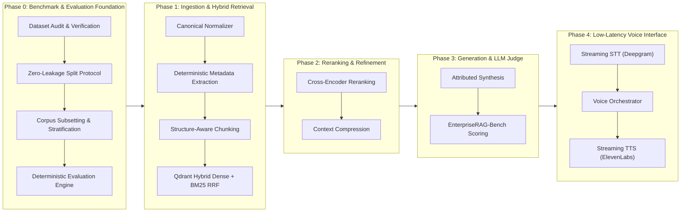

# VoiceEnterprise

## Enterprise-Grade Retrieval-Augmented Generation for Complex Workplace Knowledge

[](https://www.python.org/)
[](LICENSE)
[]()
[](https://huggingface.co/datasets/onyx-dot-app/EnterpriseRAG-Bench)

---

## Abstract and Project Objective

Modern enterprise knowledge is distributed across disparate operational silos: asynchronous communication platforms (Slack), email correspondence (Gmail), issue trackers (Linear, Jira), internal documentation systems (Confluence, Google Drive), version control systems (GitHub), CRM platforms (HubSpot), and automated meeting transcription feeds (Fireflies).

Standard semantic search models encounter significant failure modes in enterprise domains due to:
1. Cross-document entity ambiguity and conflicting records across tools.
2. Temporal evolution of documentation (e.g., historical runbooks superseded by recent chat announcements).
3. Complex multi-hop constraints requiring joint synthesis across multiple data sources.
4. Severe precision penalties when retrieving irrelevant documents for unanswerable or constrained queries.

The objective of **VoiceEnterprise** is to design, evaluate, and deploy a production-grade conversational agent backed by a robust Retrieval-Augmented Generation (RAG) architecture. The retrieval engine is engineered to support low-latency voice interaction while strictly optimizing precision, recall, and factual provenance.

The system is developed and benchmarked against **EnterpriseRAG-Bench** (Onyx), an evaluation standard comprising **511,962 documents** spanning 9 SaaS tools and **500 multi-category evaluation questions**.

---

## Architectural Roadmap



| Phase | Module | Status | Deliverables |
| :--- | :--- | :---: | :--- |
| **Phase 0** | **Dataset Audit, Leak-Free Protocol & Evaluation Suite** | Completed | Full cryptographic audit, connected-component split protocol, representative 10k/12k subsets, official benchmark metrics. |
| **Phase 1** | **Canonical Ingestion & Hybrid Dense-Sparse Retrieval** | Completed | Duplicate-ID resolution, temporal/ticket metadata extraction, heading-aware chunker, Qdrant hybrid (BGE-small-en-v1.5 + BM25 RRF). |
| **Phase 2** | **Re-ranking, RRF Calibration & Context Compression** | Planned | Cross-encoder verification, temporal decay filtering, prompt context compaction. |
| **Phase 3** | **Synthesis, Fact Attribution & Benchmark Evaluation** | Planned | Grounded response generation, LLM-as-a-judge scoring (Completeness and Correctness). |
| **Phase 4** | **Real-Time Voice Architecture (STT + TTS)** | Planned | Streaming audio pipeline with low time-to-first-token, barge-in handling, and audio citation playback. |

---

## Phase 0: Methodology and Experimental Protocol

### 1. Corpus Cryptographic Audit and Referential Integrity (P0.1)
- The raw benchmark corpus was obtained from `onyx-dot-app/EnterpriseRAG-Bench`.
- Checksums were computed and validated against upstream Git Large File Storage (LFS) pointers:
  - `documents/test.parquet`: SHA-256 `6b0747bf160af9427b12101537d53056ac592ada9831c1a98ae01fa50a8d2a9f` (511,962 rows).
  - `questions/test.parquet`: SHA-256 `e25066f4eff3843dd0f3df0d1348113471e072e75007ffe390a0aa83f2a80af2` (500 rows).
- **Referential Integrity**: All 722 distinct gold document identifiers (`expected_doc_ids`) referenced by the questions are verified to exist in the corpus without orphaned references.
- **Corpus Anomalies Identified**:
  - **Duplicate `doc_id` records**: 4 identifiers are duplicated across divergent content and disparate source types (e.g., Confluence vs. Jira, Confluence vs. HubSpot).
  - **Missing fields**: 15 Slack records possess empty string titles; 1 Slack record contains empty string content.
- The verified audit specification is serialized in [`data/manifest.json`](file:///Users/kanchanpotdar/Downloads/voice%20ai%20/data/manifest.json).

### 2. Leak-Free Question Splitting Protocol (P0.2)
To avoid evaluation contamination, questions that share any gold document must not be split across development and test sets.
- A bipartite graph connecting questions to their expected document identifiers was constructed.
- Connected components were computed using [`data/split_questions.py`](file:///Users/kanchanpotdar/Downloads/voice%20ai%20/data/split_questions.py). Questions within the same connected component are assigned atomically to either dev or held-out test.
- Small question categories ($\le 30$ instances, such as `conflicting_info` and `completeness`) were assigned 50% allocation to development to ensure adequate statistical support. Larger categories were assigned 35%.
- **Resulting Splits**:
  - **Development Split (`questions_dev.parquet`)**: 193 questions, 277 unique gold documents, tagged with 5-fold cross-validation folds.
  - **Held-Out Test Split (`questions_held_out_test.parquet`)**: 307 questions, 445 unique gold documents.
  - **Gold Document Inter-Split Overlap**: Exactly 0 documents.
- Full partition parameters are detailed in [`data/splits/split_protocol.json`](file:///Users/kanchanpotdar/Downloads/voice%20ai%20/data/splits/split_protocol.json).

### 3. Representative Corpus Subsetting (P0.3)
Full corpus indexing of 511,962 documents creates substantial latency during local hyperparameter search. Two deterministic subsets were constructed in [`data/build_subset.py`](file:///Users/kanchanpotdar/Downloads/voice%20ai%20/data/build_subset.py):
- **`corpus_dev_10k.parquet`** (10,001 documents, 29.2 MB): Conditioned strictly on the development split. Incorporates 278 development gold documents, 2,200 title-matched hard negatives, and 7,523 stratified background documents across all 9 source types. Zero held-out test contamination.
- **`corpus_benchmark_conditioned_12k.parquet`** (11,937 documents, 33.8 MB): Conditioned across all 722 gold documents for comprehensive end-to-end sanity testing.
- Sampling manifests and inclusion rationales are recorded in [`data/subsets/subset_manifest.json`](file:///Users/kanchanpotdar/Downloads/voice%20ai%20/data/subsets/subset_manifest.json).

### 4. Deterministic Evaluation Suite (P0.4)
The evaluation module in [`evaluation/metrics.py`](file:///Users/kanchanpotdar/Downloads/voice%20ai%20/evaluation/metrics.py) implements the official EnterpriseRAG-Bench metrics:
- **Recall@K** and **Recall (all)**: Measures proportion of expected documents retrieved. Explicitly returns `None` for questions with zero expected documents (e.g., `info_not_found`) to prevent skewing averages.
- **Hit@K**: Binary indicator of whether at least one relevant document is present in the top-K.
- **MRR@K (Mean Reciprocal Rank)**: Position-weighted relevance metric.
- **Invalid Extra Docs@K**: Measures retrieved noise outside the gold set (crucial penalty indicator).
- **Overall Score**: $Completeness \times Correctness$ as defined by the benchmark.
- Automated per-category breakdowns with low-sample size warnings for categories with $n < 15$.

---

## Phase 1: Ingestion and Retrieval Pipeline

1. **Document Normalization (`ingestion/normalizer.py`)**:
   - Resolves conflicting `doc_id` records into deterministic versions (`{doc_id}__v1`, `{doc_id}__v2`) while preserving canonical `doc_id` for ground-truth alignment.
   - Synthesizes informative fallback titles for untitled records based on source type and opening line content.
   - Enforces provenance tracking with boolean indicators (`has_duplicate_doc_id_conflict`, `title_was_empty`, `content_was_empty`).

2. **Deterministic Metadata Extraction (`ingestion/metadata.py`)**:
   - Extracts ISO dates (`YYYY-MM-DD`) with explicit provenance and confidence tiers (`high` for title or revision history headers, `medium` for body occurrences).
   - Detects Slack channels (`#channel-name`), Jira/Linear issue keys (`[A-Z]+-[0-9]+`), PR references, and email addresses.

3. **Structure-Aware Document Chunker (`ingestion/chunker.py`)**:
   - Parses Markdown headers and document dividers, maintaining section hierarchy.
   - Emits contextualized prefixes (`[Source | Title | Section]`) to enhance dense embedding and sparse lexical matching.

4. **Hybrid Indexer & Retriever (`retrieval/indexer.py`)**:
   - **Dense**: `BAAI/bge-small-en-v1.5` (384-dimensional Cosine space) accelerated via Apple Silicon Metal Performance Shaders (`mps` FP16) with dynamic batching.
   - **Sparse**: `Qdrant/bm25` with inverted document frequency collection parameters.
   - **Fusion**: Reciprocal Rank Fusion (RRF) combining dense and lexical search candidates.

---

## Repository Structure

```
.
├── .env.example                       # Environment configuration template
├── .gitignore                          # Excludes datasets, parquet binaries, and secrets
├── pyproject.toml                      # Pytest and module configuration
├── README.md                           # Technical documentation and roadmap
│
├── data/
│   ├── audit.py                        # Dataset audit & SHA-256 verification
│   ├── manifest.json                   # Machine-readable audit report
│   ├── split_questions.py              # Connected-component leak-free question splitter
│   ├── build_subset.py                 # 10k/12k corpus subset sampler with hard negatives
│   ├── splits/
│   │   └── split_protocol.json         # Split metadata, seeds, and category distributions
│   └── subsets/
│       └── subset_manifest.json        # Subset provenance and sampling statistics
│
├── evaluation/
│   ├── __init__.py
│   └── metrics.py                      # Recall@K, Hit@K, MRR@K, Invalid Extra Docs suite
│
├── ingestion/
│   ├── __init__.py
│   ├── normalizer.py                   # Canonical normalization & duplicate-ID resolution
│   ├── metadata.py                     # Deterministic date, ticket, and channel extraction
│   ├── chunker.py                      # Structure-aware heading and section chunker
│   └── pipeline.py                     # End-to-end ingestion orchestrator
│
├── retrieval/
│   ├── __init__.py
│   ├── indexer.py                      # Qdrant Dense (BGE) + Sparse (BM25) hybrid retriever
│   └── benchmark_p1.py                 # Retrieval benchmark evaluation runner
│
└── tests/
    ├── test_p0_pipeline.py             # Phase 0 integrity, leak-free, and subset tests
    ├── test_metrics.py                 # Unit tests for evaluation metrics
    ├── test_ingestion.py               # Normalizer, metadata, and chunker tests
    └── test_retrieval.py               # Hybrid retriever and Qdrant integration tests
```

---

## Reproduction and Verification

### 1. Environment Setup
```bash
# Clone the repository
git clone https://github.com/kanchanpotdar/voicenterprise.git
cd voicenterprise

# Create and activate virtual environment
python3.11 -m venv .venv
source .venv/bin/activate

# Install dependencies
pip install duckdb pyarrow pandas qdrant-client transformers fastembed torch pytest
cp .env.example .env
```

### 2. Execution of Test Suite
```bash
pytest tests -v
```
All 14 unit and integration tests validate the data pipeline, metric implementations, normalization rules, and retrieval mechanisms.

### 3. Pipeline Reproduction
```bash
# Execute dataset cryptographic audit
python -m data.audit

# Generate leak-free partitions
python -m data.split_questions

# Construct 10k development subset with mined hard negatives
python -m data.build_subset
```

---

## License

This project is distributed under the MIT License. EnterpriseRAG-Bench dataset is distributed under the MIT License by Onyx.
